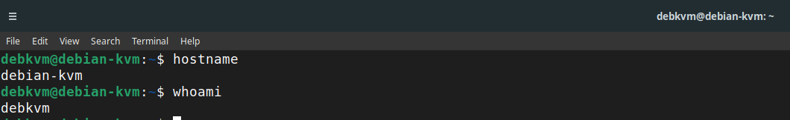
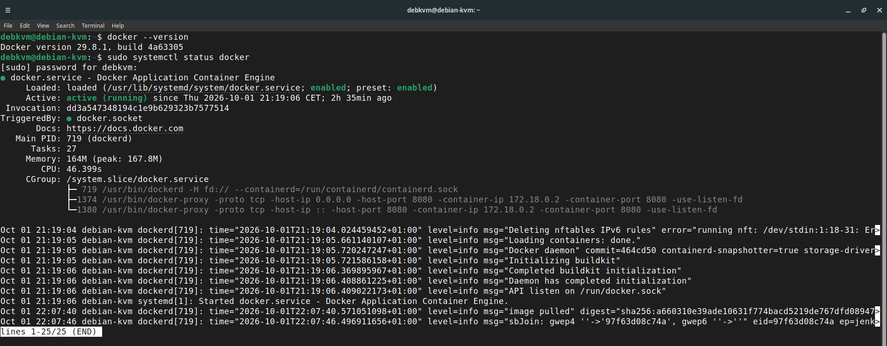
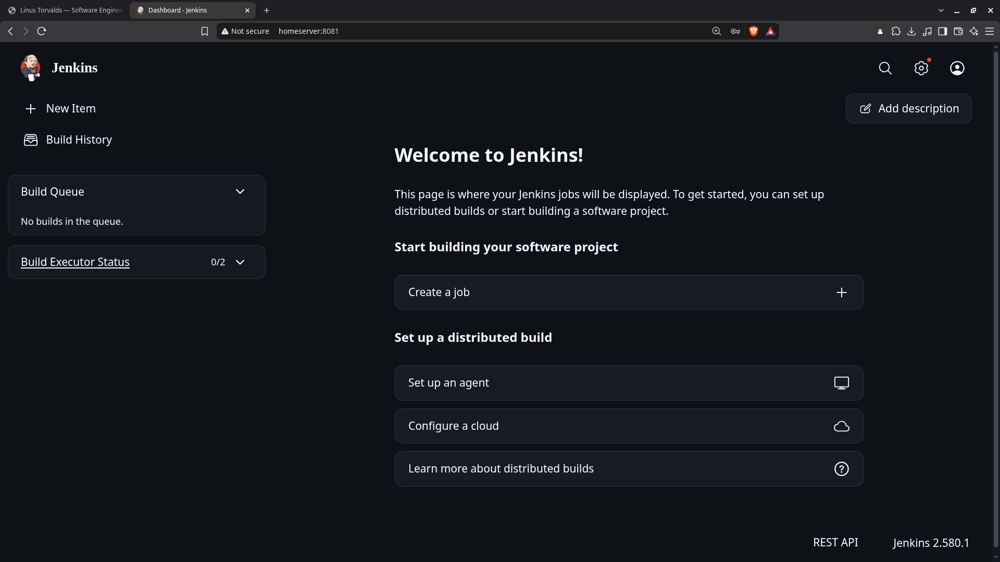
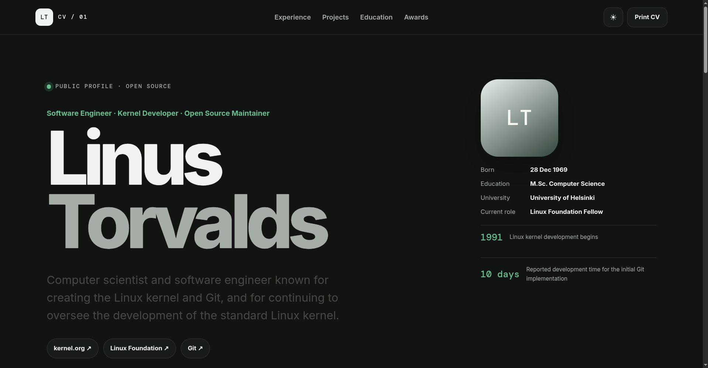
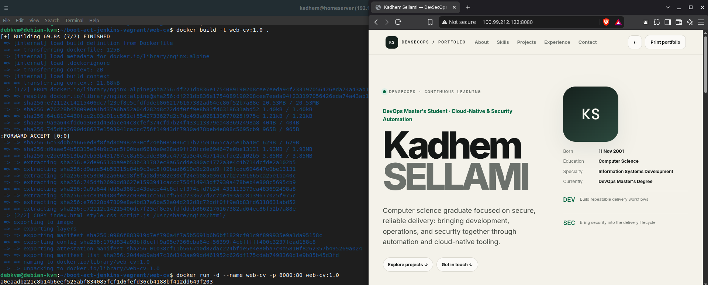
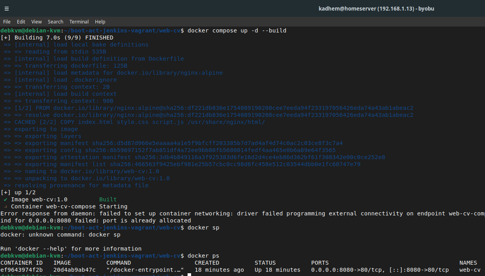
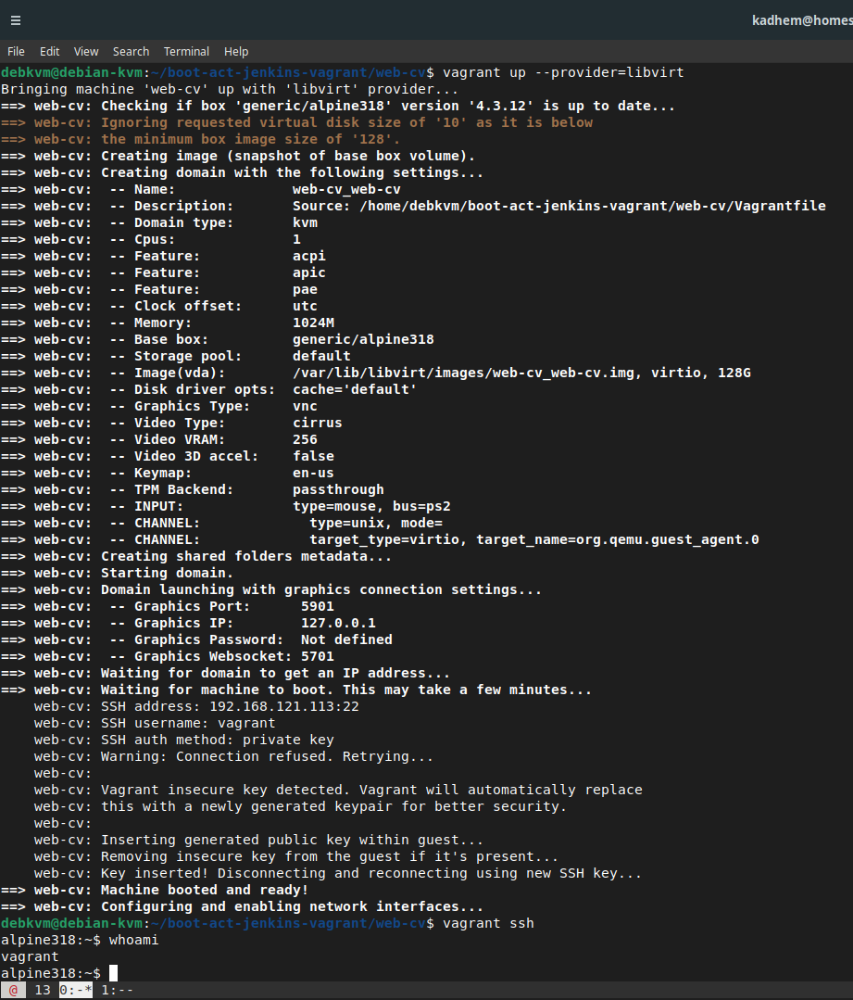
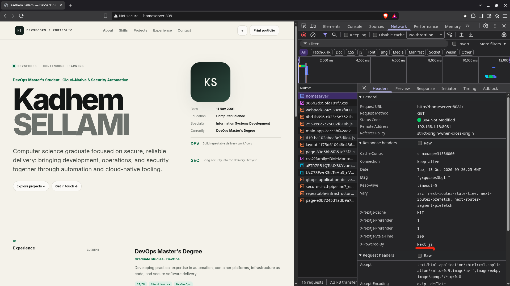
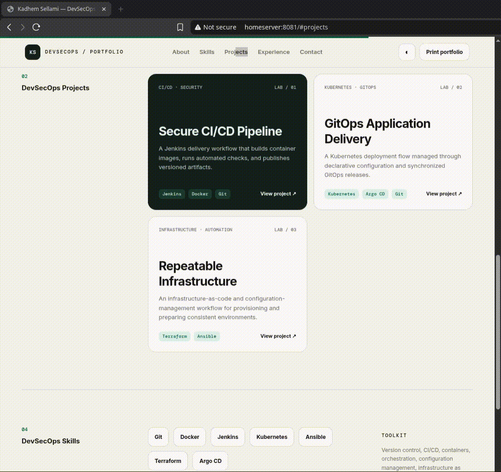
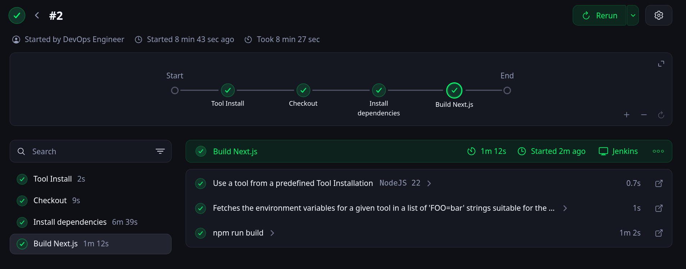

# DevSecOps Portfolio

**Professor:** [Wahid HAMDI](https://github.com/sellami1)

**Scope:** End-to-end DevSecOps lab on one evolving Portfolio app: provisioning/containerization, Next.js/Express/PostgreSQL modernization, secure CI/CD and supply chain, IaC with local AWS, Kubernetes hardening, GitOps/observability, advanced delivery, and platform engineering/operations.

**Convention:** All screenshots are stored in `docs/screenshots/` and referenced below (`aX-NN-<label>.png`).

---

## 1. Activity 1 — Initial Setup and Containerization

**Objective:** Provision an Ubuntu Server VM, secure it with SSH, install Docker and Jenkins, build a mini-CV/DevSecOps Portfolio, containerize it, and introduce Vagrant-based automation.

### 1.1 Ubuntu Server installation (Task 1)

Ubuntu Server 26.04 LTS installed on a VirtualBox VM with a NAT + host-only adapter (static IP `192.168.56.10`). OpenSSH server selected during installation.

```bash
lsb_release -a
ip -4 addr show | grep inet
```

### 1.2 SSH access (Task 2)

```bash
sudo systemctl status ssh
# From the host machine
ssh ubuntu@192.168.56.10
```



### 1.3 Docker installation (Task 3)

```bash
sudo apt update && sudo apt install -y ca-certificates curl gnupg
curl -fsSL https://get.docker.com | sudo sh
sudo usermod -aG docker $USER && newgrp docker
docker --version
docker run --rm hello-world
```



### 1.4 Jenkins installation (Task 4)

```bash
sudo apt install -y openjdk-21-jre
curl -fsSL https://pkg.jenkins.io/debian-stable/jenkins.io-2023.key \
  | sudo tee /usr/share/keyrings/jenkins-keyring.asc > /dev/null
echo "deb [signed-by=/usr/share/keyrings/jenkins-keyring.asc] \
  https://pkg.jenkins.io/debian-stable binary/" \
  | sudo tee /etc/apt/sources.list.d/jenkins.list > /dev/null
sudo apt update && sudo apt install -y jenkins
sudo systemctl status jenkins
sudo cat /var/lib/jenkins/secrets/initialAdminPassword
```

Jenkins reachable at `http://192.168.56.10:8080`.



### 1.5 Mini-CV → DevSecOps Portfolio (Tasks 5, 7–9)

A one-page CV (`index.html`, `style.css`, `script.js`) was first created, then evolved into a portfolio with the sections **About, Skills, Projects, Experience, Contact** and **DevSecOps Skills** (Git, Docker, Jenkins, Kubernetes, Ansible, Terraform, Argo CD). Projects are rendered dynamically from a JavaScript array.

```bash
mkdir devsecops-portfolio && cd devsecops-portfolio
git init
# ... create index.html, style.css, script.js, assets/
git add . && git commit -m "feat: initial DevSecOps portfolio"
```



```javascript
// script.js — dynamic project rendering (extract)
const projects = [
  { name: "DevSecOps Portfolio", stack: "Next.js, Docker, Jenkins" },
  { name: "CI/CD Hardening",     stack: "GitHub Actions, Trivy, Cosign" },
];
const grid = document.querySelector("#projects-grid");
projects.forEach(p => {
  const card = document.createElement("article");
  card.className = "card";
  card.innerHTML = `<h3>${p.name}</h3><p>${p.stack}</p>`;
  grid.appendChild(card);
});
```

### 1.6 GitHub SSH authentication (Task 6)

```bash
ssh-keygen -t ed25519 -C "kadhem@devsecops" -f ~/.ssh/id_ed25519 -N ""
cat ~/.ssh/id_ed25519.pub      # paste into GitHub → Settings → SSH and GPG keys
ssh -T git@github.com
git remote add origin git@github.com:<user>/devsecops-portfolio.git
git push -u origin main
```


### 1.7 Containerization (Tasks 10–14)

**Dockerfile (Nginx, Task 10):**

```dockerfile
FROM nginx:1.27-alpine
COPY . /usr/share/nginx/html
EXPOSE 80
```

```bash
docker build -t cv-docker .                          # Task 11
docker run -d --name cv -p 8080:80 cv-docker         # Task 12
docker ps
```



**Docker Compose (Task 13):**

```yaml
services:
  web:
    image: cv-docker
    build: .
    ports:
      - "8080:80"
```

```bash
docker compose up -d
docker compose ps
```



**Publication to GitHub (Task 14):**

```bash
git add Dockerfile docker-compose.yml
git commit -m "feat: containerize portfolio with Docker and Compose"
git push origin main
```

### 1.8 Vagrant automation (Tasks 15–17)

```bash
vagrant --version
```

`Vagrantfile`:

```ruby
Vagrant.configure("2") do |config|
  config.vm.box = "ubuntu/jammy64"
  config.vm.hostname = "devsecops-vm"
  config.vm.network "private_network", ip: "192.168.56.20"
  config.vm.provider "virtualbox" do |vb|
    vb.memory = 2048
    vb.cpus   = 2
  end
end
```

```bash
vagrant up        # Task 15
vagrant ssh       # Task 16
vagrant status    # Task 17
```



---

## 2. Activity 2 — Next.js Migration and First Jenkins Pipeline

**Objective:** Re-implement the portfolio in Next.js with reusable components and separated data, then build a first Jenkins pipeline that clones, installs dependencies, and builds the application.

### 2.1 Next.js application (Task 18)

```bash
npx create-next-app@latest devsecops-portfolio \
  --ts --eslint --tailwind --app --src-dir --import-alias "@/*"
cd devsecops-portfolio && npm run dev
```



### 2.2 Reusable components (Task 19)

```
src/components/
├── Header.tsx
├── About.tsx
├── Skills.tsx
├── Projects.tsx
├── Contact.tsx
└── Footer.tsx
```

Each section of the former static page was extracted into a presentational component, composed in `src/app/page.tsx`.

### 2.3 Separated data (Task 20)

```typescript
// src/data/projects.ts
export const projects = [
  { slug: "devsecops-portfolio", title: "DevSecOps Portfolio", stack: ["Next.js", "Docker", "Jenkins"] },
  { slug: "ci-cd-hardening",     title: "CI/CD Hardening",     stack: ["GitHub Actions", "Trivy", "Cosign"] },
];
```

```typescript
// src/data/skills.ts
export const skills = [
  { category: "DevSecOps", items: ["Git", "Docker", "Jenkins", "Kubernetes", "Ansible", "Terraform", "Argo CD"] },
];
```

### 2.4 Project pages (Task 21)

- `src/app/projects/page.tsx` — project index.
- `src/app/projects/[slug]/page.tsx` — dynamic project detail page.

```tsx
// src/app/projects/[slug]/page.tsx (extract)
export default async function ProjectPage({ params }: { params: { slug: string } }) {
  const project = projects.find(p => p.slug === params.slug);
  if (!project) notFound();
  return <article><h1>{project.title}</h1></article>;
}
```



### 2.5 First Jenkins pipeline (Tasks 22–24)

`Jenkinsfile`:

```groovy
pipeline {
  agent any
  tools { nodejs 'node-21' }
  stages {
    stage('Checkout') {
      steps { git branch: 'main', url: 'git@github.com:<user>/devsecops-portfolio.git' }   // Task 22
    }
    stage('Install') {
      steps { sh 'npm ci' }                                                                // Task 23
    }
    stage('Build') {
      steps { sh 'npm run build' }                                                         // Task 24
    }
  }
  post { always { archiveArtifacts artifacts: '.next/**', allowEmptyArchive: true } }
}
```

```bash
sudo systemctl status jenkins   # Jenkins must be reachable from the host
```



---

## 3. Deliverables and Evidence

| Activity | Task | Deliverable | Evidence |
|---|---|---|---|
| 1 | 1 | Ubuntu Server VM reachable | `a1-02-ssh-access.png` |
| 1 | 2 | SSH access from host | `a1-02-ssh-access.png` |
| 1 | 3 | Docker installed | `a1-03-docker.png` |
| 1 | 4 | Jenkins running on `:8080` | `a1-04-jenkins.png` |
| 1 | 5–9 | DevSecOps Portfolio (static) | `a1-05-portfolio.png` |
| 1 | 6 | GitHub SSH push | `a1-06-github-ssh.png` |
| 1 | 10–12 | `cv-docker` image served | `a1-12-container.png` |
| 1 | 13 | Docker Compose deployment | `a1-13-compose.png` |
| 1 | 14 | GitHub repo updated | commit history |
| 1 | 15–17 | Vagrant VM automated | `a1-17-vagrant-status.png` |
| 2 | 18 | Next.js portfolio | `a2-18-nextjs.png` |
| 2 | 19 | Reusable components | `src/components/` |
| 2 | 20 | Data files | `src/data/` |
| 2 | 21 | Project pages | `a2-21-project-page.gif` |
| 2 | 22–24 | Jenkins pipeline (checkout/install/build) | `a2-24-jenkins-pipeline.png` |

---

## 4. Repository Structure (end of Activity 2)

```
devsecops-portfolio/
├── docs/screenshots/          # evidence referenced above
├── public/
├── src/
│   ├── app/
│   │   ├── page.tsx
│   │   └── projects/
│   │       ├── page.tsx
│   │       └── [slug]/page.tsx
│   ├── components/
│   └── data/
├── Dockerfile
├── docker-compose.yml
├── Jenkinsfile
├── Vagrantfile
├── package.json
└── README.md
```
## 3. Activity 3 — Ansible Automation, Express API and Dockerization

**Objective:** Automate server configuration with Ansible, build an Express API exposing the portfolio data (`/api/health`, `/api/profile`, `/api/projects`, `/api/skills`), wire the Next.js frontend to consume it through an environment-based `API_URL`, and package both tiers as Docker images orchestrated by Docker Compose.

---

## 4. Activity 4 — API Hardening, PostgreSQL and Jenkins DevSecOps Pipeline

**Objective:** Secure the Express API (`POST /api/contact`, Zod validation, centralized error handling, Helmet, rate limiting), persist contact messages in PostgreSQL with Prisma migrations, add frontend/API/integration tests, and extend the Jenkins pipeline with secret scanning, SAST, dependency and image scans that fail on critical findings.

---

## 5. Activity 5 — GitHub Actions, Git Workflow, Image Optimization and Supply Chain Security

**Objective:** Build a GitHub Actions workflow (tests, SAST, dependency check, image build, Trivy) with restricted `GITHUB_TOKEN` permissions and SHA-pinned actions, adopt a branch/PR/Conventional Commits/SemVer workflow with branch protection, optimize Dockerfiles through multi-stage and multi-arch builds, publish images to Harbor, and secure the supply chain with SBOMs, Cosign signatures, build attestations and SLSA/in-toto positioning.

---

## 6. Activity 6 — Local Cloud (Floci), Terraform and Terraform + Ansible Automation

**Objective:** Emulate AWS locally with Floci (S3, SQS, DynamoDB, Lambda, Secrets Manager), provision those resources with Terraform (modules, dev/staging/prod, remote S3 state with locking), enforce IaC security with Checkov/Trivy, explore OpenTofu, Terragrunt and Pulumi, and combine Terraform provisioning with Ansible configuration for a fully reproducible environment.

---

## 7. Activity 7 — Kubernetes (K3s), Hardening and Continuous Security

**Objective:** Deploy the portfolio on K3s with ConfigMaps, Secrets, PVC-backed PostgreSQL and TLS-terminated Ingress, enforce health probes, requests/limits and HPA, apply RBAC and Pod Security Standards, restrict traffic with NetworkPolicies (and Cilium/Hubble), codify policies with Kyverno (and OPA Gatekeeper), manage secrets with Vault + External Secrets + Sealed Secrets, and detect drift at runtime with Trivy Operator, Kubescape and Falco.

---

## 8. Activity 8 — Helm, Kustomize, GitOps with Argo CD and Observability Stack

**Objective:** Package the application with Helm and Kustomize overlays, enforce signed-image deployment with Kyverno `verifyImages`, deploy through Argo CD with a dedicated GitOps repo (self-healing, image bumps, ApplicationSet across environments), and build the full observability stack — Prometheus, Grafana, Loki, Tempo and OpenTelemetry — with SLI/SLO alerts, runbooks, OWASP ZAP DAST and k6 performance gating.

---

## 9. Activity 9 — Progressive Delivery, Data Resilience, Identity, Service Mesh and CI/CD Hardening

**Objective:** Implement Blue/Green and Canary releases with Argo Rollouts and Prometheus-driven auto-rollback, add OpenFeature feature flags, run PostgreSQL through CloudNativePG with S3 backups, protect the namespace with Velero (backup → delete → restore), add Keycloak OIDC with role-based route protection, encrypt service-to-service traffic and split traffic with Istio, and replace static credentials with OIDC federation and least-privilege self-hosted runners.

---

## 10. Activity 10 — Platform Engineering, FinOps, Chaos and Incident Management

**Objective:** Reproduce the pipeline in GitLab CI/CD and compare it with Jenkins and GitHub Actions, deploy the portfolio with Flux CD and compare it with Argo CD, manage a second K3s cluster through Argo CD `ApplicationSet` and explore Karmada, provision cloud resources with Crossplane (XRD/Composition) and kro, stand up a Backstage-based Internal Developer Platform with a Golden Path, measure DORA metrics and FinOps costs with OpenCost, and validate resilience and incident response with Chaos Mesh experiments and a post-mortem.