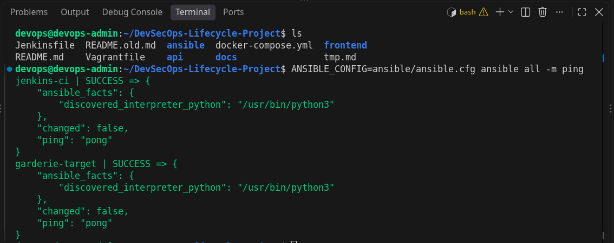
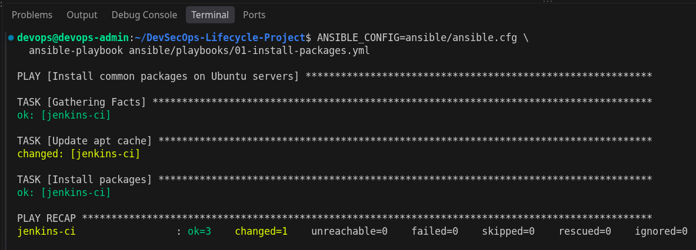
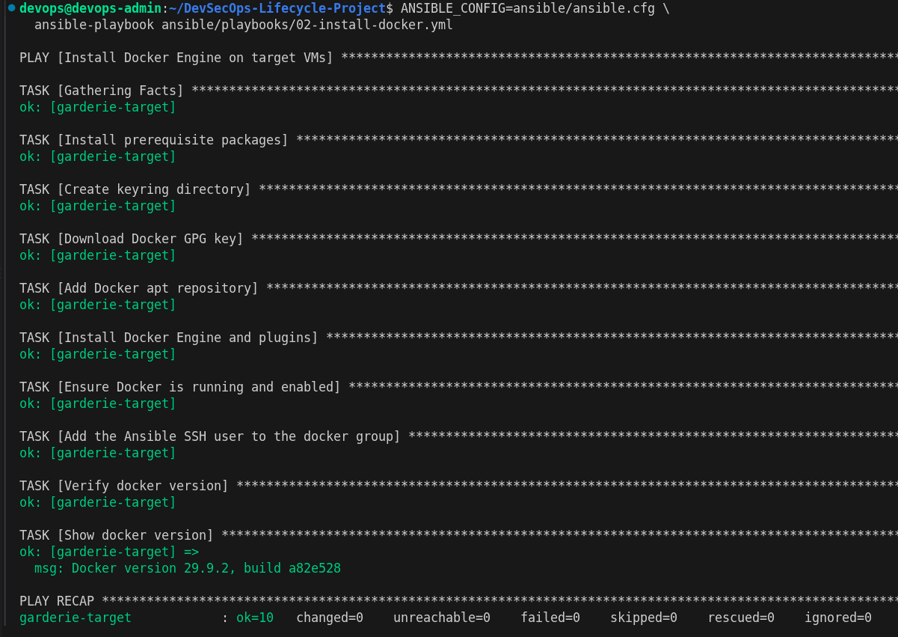
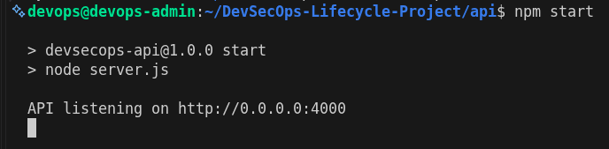
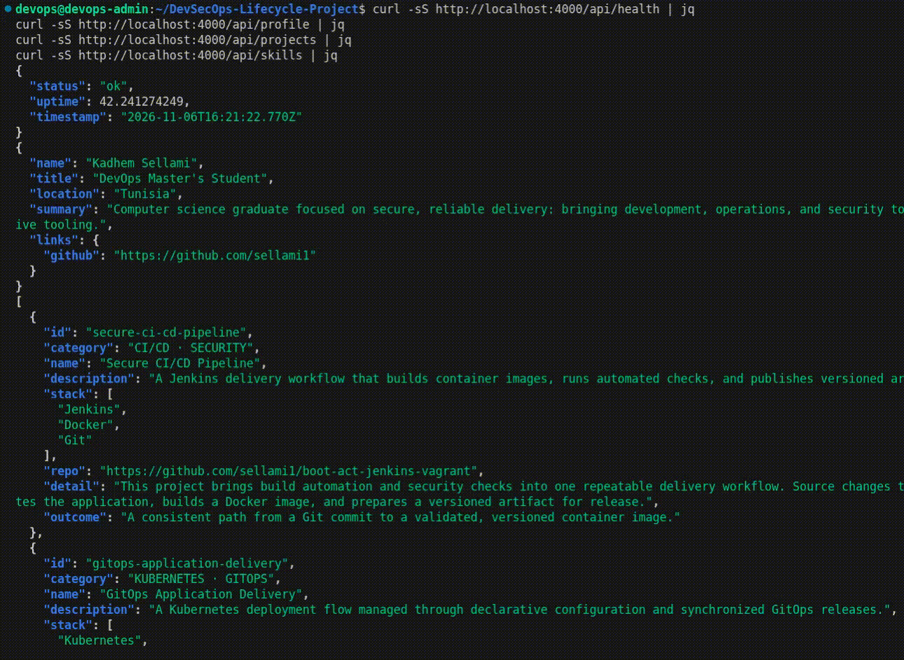
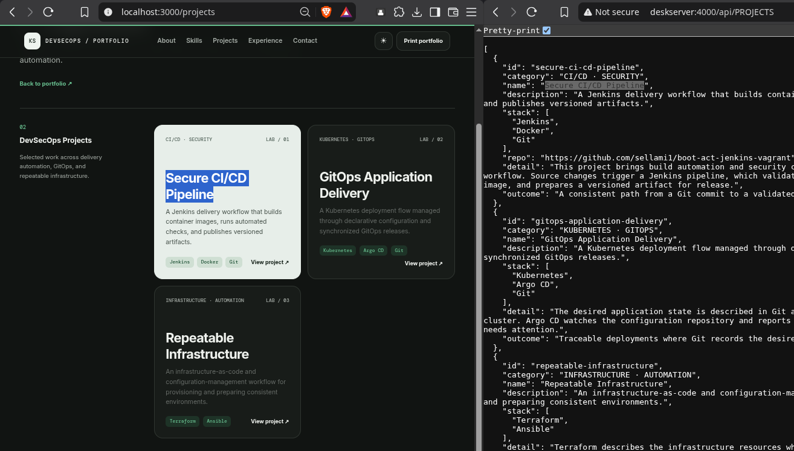
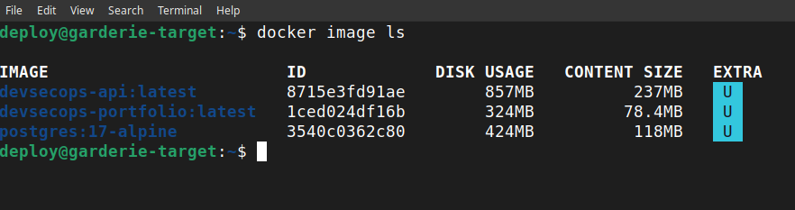
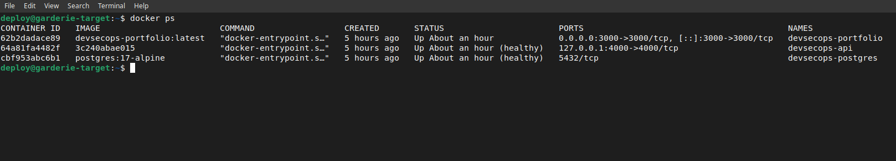

# Activity 3 — Ansible, Express API and Dockerization

This document records the implementation and commands for tasks 25–42 in [activity3-content.md](../activities/activity3-content.md). Screenshots marked **Add screenshot** are placeholders for evidence to capture manually; no screenshot is represented as already taken.

## VII. Ansible automation

Ansible is installed on the `devops-admin` VM, which is the control node. The inventory and Ansible configuration are in [`ansible/`](../../ansible/).

### 25. Check Ansible on the administration VM

```bash
ansible --version
```

Verified on `devops-admin`: Ansible Core `2.16.3`.

### 26. Inventory and connection test

The inventory is [`ansible/inventory.ini`](../../ansible/inventory.ini). It defines the `apt_servers` group for Debian-family hosts and `garderie-target` in the `docker_targets` group, including each VM's reachable address, SSH user, and private-key path. Keep the connection values consistent with the VMs.

```bash
ANSIBLE_CONFIG=ansible/ansible.cfg ansible all -m ping
```

Expected result: `SUCCESS` and `"ping": "pong"` for each reachable inventory host.

Verified: both `jenkins-ci` and `garderie-target` returned `pong`.

**Screenshot:** successful `ansible all -m ping` output.



### 27. Install common Linux packages

The playbook [`01-install-packages.yml`](../../ansible/playbooks/01-install-packages.yml) installs curl, git, and jq on the `apt_servers` group.

```bash
ANSIBLE_CONFIG=ansible/ansible.cfg \
  ansible-playbook ansible/playbooks/01-install-packages.yml
```

Verified: the playbook completed successfully on `jenkins-ci`.

**Screenshot:** successful playbook output.



### 28. Install and verify Docker

The playbook [`02-install-docker.yml`](../../ansible/playbooks/02-install-docker.yml) installs Docker Engine and its Compose plugin on `docker_targets`, enables the service, and adds the Ansible SSH user to the `docker` group. It also reports `docker --version`.

```bash
ANSIBLE_CONFIG=ansible/ansible.cfg \
  ansible-playbook ansible/playbooks/02-install-docker.yml
```

Docker was already installed on `garderie-target`; verify its version directly:

```bash
ANSIBLE_CONFIG=ansible/ansible.cfg \
  ansible docker_targets -m command -a 'docker --version'
```

The playbook completed successfully on `garderie-target`; the reported version was `Docker version 29.9.2, build a82e528`.

**Screenshot:** the playbook's Docker version result or the remote verification output.



## VIII. Node.js / Express API

The API is an independent Node.js application in [`api/`](../../api/). Its Express server exposes the routes below and listens on port `4000` by default.

### 29. Start the API independently

```bash
cd api
cp .env.example .env
npm install
npm start
```

The server prints `API listening on http://0.0.0.0:4000`. It can run independently from the Next.js frontend.

**Screenshot:** API server running in a terminal.



### 30–33. Check API routes

In another terminal:

```bash
curl -sS http://localhost:4000/api/health | jq
curl -sS http://localhost:4000/api/profile | jq
curl -sS http://localhost:4000/api/projects | jq
curl -sS http://localhost:4000/api/skills | jq
```

The routes return the health status and the profile, projects, and skills data defined in [`api/data/`](../../api/data/).

Verified locally on the administration VM: all four routes returned JSON, and `/api/health` returned `"status":"ok"`.

The profile route returned:

```json
{
  "name": "Kadhem Sellami",
  "title": "DevOps Master's Student",
  "location": "Tunisia",
  "summary": "Computer science graduate focused on secure, reliable delivery: bringing development, operations, and security together through automation and cloud-native tooling.",
  "links": {
    "github": "https://github.com/sellami1"
  }
}
```

**Screenshots:** api calling responses.



## IX. Environment and frontend integration

The Next.js server fetches profile, projects, and skills from Express using the helpers in [`frontend/lib/api.js`](../../frontend/lib/api.js). The home page and project list fetch data at request time instead of relying only on local project/skill data.

### 34–35. Fetch projects and skills from Express

The integration is implemented in [`frontend/app/page.jsx`](../../frontend/app/page.jsx) and [`frontend/app/projects/page.jsx`](../../frontend/app/projects/page.jsx). Start the API first, then run Next.js:

```bash
cd frontend
npm install
API_URL=http://localhost:4000 npm run dev
```

Open `http://localhost:3000` and confirm the project cards and skills are displayed. The `/projects` page also gets its list from Express.

**Screenshot:** frontend showing projects and skills returned by the API.



### 36–37. Configure `API_URL` and example environment variables

The root [`.env.example`](../../.env.example) contains:

```dotenv
API_URL=http://api:4000
```

Copy it to `.env` for Compose:

```bash
cp .env.example .env
```

Compose passes this server-side URL to the frontend. The default `http://api:4000` is the Compose service name; outside Compose, use `http://localhost:4000`. Keeping the address in an environment variable avoids baking environment-specific URLs into application code and allows the same image to run in different environments. `.env` is ignored by Git; do not put real secrets in the example file.

The API's own [`api/.env.example`](../../api/.env.example) documents its local port:

```dotenv
PORT=4000
```

## X. Docker frontend + API

The frontend image is built from [`frontend/Dockerfile`](../../frontend/Dockerfile), which uses Next.js standalone output and runs as an unprivileged user. The API image is built from [`api/Dockerfile`](../../api/Dockerfile) and runs the Express server on port `4000`.

### 38–40. Build the two images

Docker is installed on `garderie-target`, not `devops-admin`. Copy the app source to the target first; in this setup the source tree is at `/tmp/devsecops-activity3`. Run these commands on `garderie-target`:

```bash
cd /tmp/devsecops-activity3
docker build -t devsecops-portfolio:latest ./frontend
docker build -t devsecops-api:latest ./api
docker image ls devsecops-portfolio
docker image ls devsecops-api
```

Both `devsecops-api:latest` and `devsecops-portfolio:latest` were created successfully.

**Screenshot:** both built images visible in `docker image ls`.



### 41–42. Start both services and verify communication

[`docker-compose.yml`](../../docker-compose.yml) builds from `./frontend` and `./api`, puts both services on the same Compose network, and sets the frontend's `API_URL` to the API service address. The API health check must pass before Compose starts the frontend.

```bash
cd /tmp/devsecops-activity3
cp .env.example .env
docker compose up --build -d
docker compose ps
curl -sS http://localhost:4000/api/health | jq
```

Verified `docker compose ps` result:

```text
NAME                  IMAGE                        STATUS
devsecops-api         devsecops-api:latest         Up (healthy)  0.0.0.0:4000->4000/tcp
devsecops-portfolio   devsecops-portfolio:latest   Up            0.0.0.0:3000->3000/tcp
```

Open `http://localhost:3000`. Confirm that project and skill data appear; the Next.js server reaches Express through `http://api:4000` on the Compose network.

Verified on `garderie-target`: both containers are running, the API reports healthy, `/api/health` returns `{"status":"ok",...}`, and requests to the frontend returned project names and skills from the API.

**Screenshot:** `docker compose ps` showing both services running, and the portfolio displaying API-provided data.


