# Activity 4 — Results

Evidence for tasks 43–69 in [activity4-content.md](../activities/activity4-content.md). The commands below are read-only status checks, not deployment or setup steps. Screenshot links are placeholders for manually adding captured evidence; they do not mean a screenshot exists.

## Deployment (tasks 43–45)

[`deploy-portfolio.yml`](../../ansible/playbooks/deploy-portfolio.yml) installs Docker, deploys the Compose stack, then checks the API and frontend. Manual deployment to `garderie-target` is limited to that host; Vagrant runs the playbook against its dedicated VM. The [Vagrantfile](../../Vagrantfile) uses `alvistack/debian-12` and forwards ports 3000 and 4000.

**Verified:** The manual deployment succeeded on Ubuntu 24.04 `garderie-target`. Vagrant provisioning also succeeded on Debian 12 (`activity4-portfolio`); the API and frontend returned HTTP 200, and Compose reported the API and PostgreSQL healthy.

Read-only checks for current status:

```bash
vagrant status activity4-portfolio
curl -fsS http://localhost:4000/api/health
curl -I http://localhost:3000/
vagrant ssh activity4-portfolio -c 'sudo docker compose -f /opt/devsecops-portfolio/docker-compose.yml ps'
```

The separate destroy-and-recreate test has **not** been run. Do not treat it as verified.

**Screenshot evidence:** Ansible deployment and accessible portfolio; Vagrant provisioning; running Compose services.

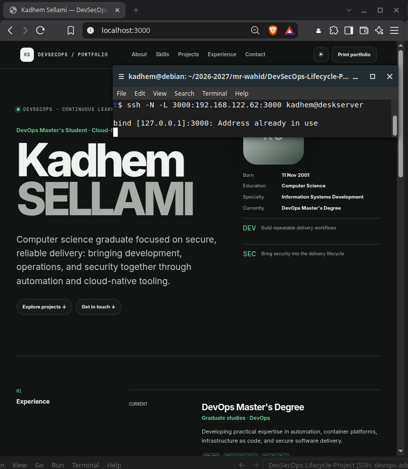
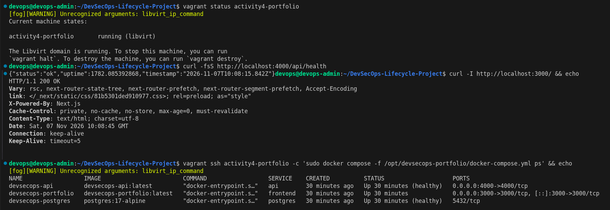

## Contact API and security (tasks 46–52)

The Next.js contact form proxies to Express `POST /api/contact`. Express validates a strict `name`/`email`/`message` schema with Zod, limits JSON bodies to 10 KB, uses Helmet and rate limiting, and returns centralized errors. CORS is not enabled. The API does not trust caller-supplied forwarding headers; in Compose, requests through the frontend share the proxy's rate-limit identity.

**Verified by API tests and integration checks:** valid contact submissions are stored; invalid and injection-shaped input and malformed JSON are rejected; security headers are present; centralized errors do not expose internal details; and rate limiting cannot be bypassed with spoofed `X-Forwarded-For`.

Observed response evidence:

```text
Valid submission: 201 Created
Invalid input:    400 VALIDATION_ERROR
Unknown route:    404
Rate limit:       429 RATE_LIMITED
Security headers: Content-Security-Policy, X-Content-Type-Options,
                  X-Frame-Options, Referrer-Policy
```

The API's default contact limit is five requests per source IP per 15 minutes. In this deployment, requests through the Next.js proxy are aggregated under that proxy. A public multi-user installation needs a trusted ingress configured to overwrite forwarding headers.

| OWASP API risk | Current mitigation or follow-up |
|---|---|
| API1–2: Object authorization and authentication | No private records or user-specific routes; add authorization before introducing them. |
| API3: Object property authorization | Strict input schema; response exposes only ID and creation time. |
| API4, API6: Resource use and sensitive flows | Rate limit, 10 KB body cap, bounded fields; consider abuse monitoring/CAPTCHA if needed. |
| API5: Function authorization | No privileged routes; require roles before adding them. |
| API7: SSRF | No caller-controlled URL fetching. |
| API8: Misconfiguration | Helmet, no permissive CORS, generic server errors. |
| API9: Inventory management | Keep route/version inventory current and remove obsolete endpoints. |
| API10: Unsafe API consumption | Proxy preserves status; form handles failures; React renders status as text. |

**Screenshot evidence:** successful contact form; rejected payload; security headers; rate-limit response.

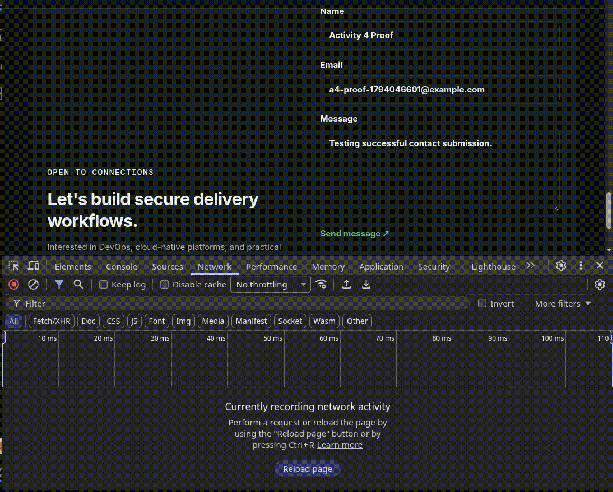
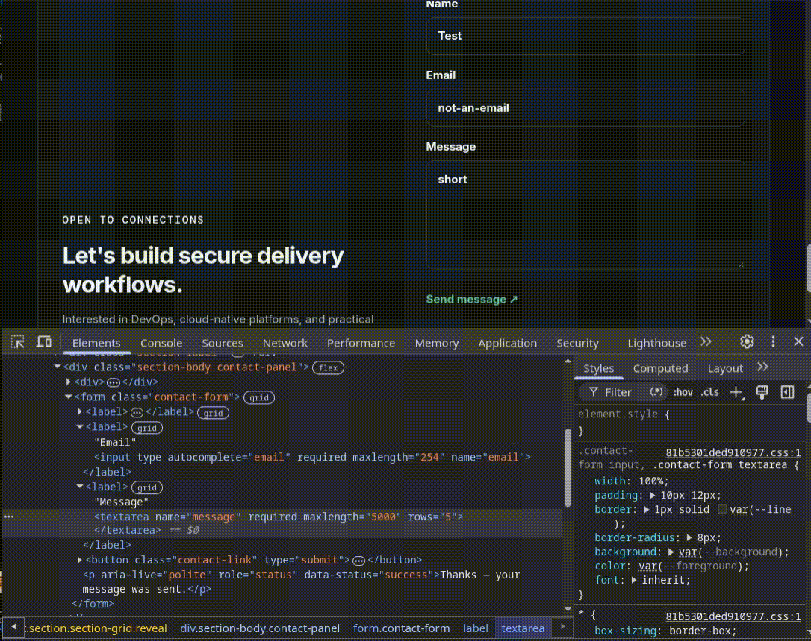
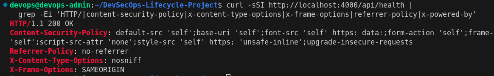
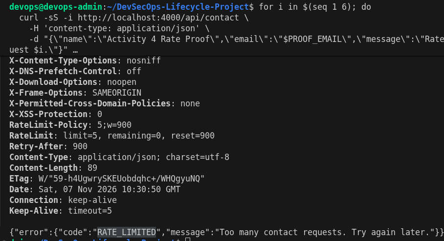

## PostgreSQL and tests (tasks 53–60)

Compose runs PostgreSQL with a persistent volume and health check. Prisma migrations run before the API serves requests; contact messages are stored in `contact_messages`. Connection examples are in [`.env.example`](../../.env.example); its credentials are for local use only.

**Verified:** PostgreSQL was healthy; Prisma created `_prisma_migrations` and `contact_messages`. The integration test submitted through the frontend, verified the PostgreSQL record, and cleaned it up.

Read-only evidence checks:

```bash
vagrant ssh activity4-portfolio -c \
  "sudo docker compose -f /opt/devsecops-portfolio/docker-compose.yml ps"
vagrant ssh activity4-portfolio -c \
  "sudo docker compose -f /opt/devsecops-portfolio/docker-compose.yml exec -T postgres psql -U portfolio -d portfolio -c '\dt'"
```

Automated results already observed:

```text
Frontend tests:          3/3 passed
API tests:               6/6 passed
Frontend lint/build:     passed
Frontend → API → DB:     1/1 integration test passed
```

The integration test removes its own test row. Unit tests reject injection-shaped input before persistence; they do not execute SQL from user input.

**Screenshot evidence:** healthy Compose services, stored contact record, frontend/API tests, integration test.

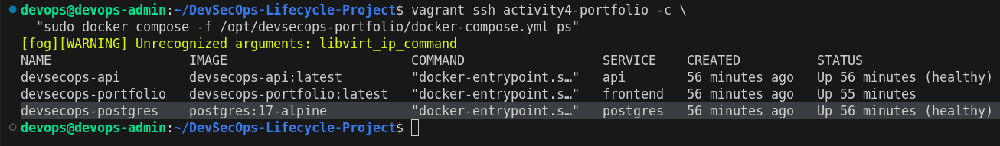
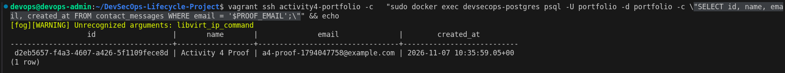
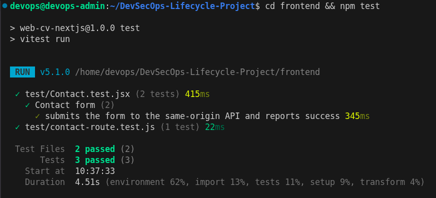
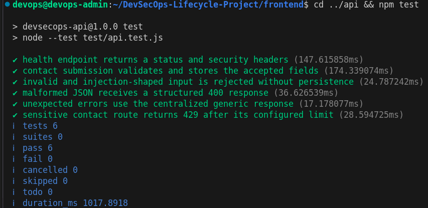
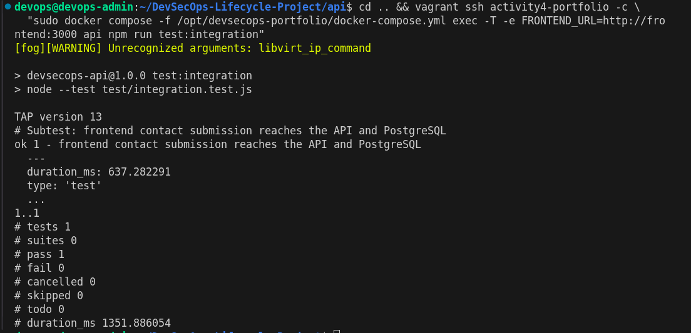

## Jenkins and security scans (tasks 61–69)

The [Jenkinsfile](../../Jenkinsfile) defines frontend/API tests, SHA-tagged Docker builds, Gitleaks, Semgrep, npm audit, OWASP Dependency-Check, and Trivy. Docker builds and scanner containers use the Jenkins **Docker Pipeline** plugin; the agent needs Docker Engine/CLI access to the local daemon. The pipeline is configured to fail on detected secrets and critical findings.

**Not verified:** The Jenkins pipeline has not been run on a configured agent. Therefore, no successful pipeline, intentional secret-failure run, or Jenkins-generated image tags are claimed here.

The lockfiles were audited separately: both `npm audit --audit-level=critical` checks passed with no critical findings. High advisories remain in the Next.js/PostCSS dependency chain and in Prisma 6/Zod 3 (including `deepmerge-ts`); they are not represented as fixed. Dependency-Check and image scan results require an actual Jenkins run.

**Screenshot — pending Jenkins execution:** pipeline test stages, SHA-tagged images, successful security pipeline, deliberate fake-secret failure, Dependency-Check report.

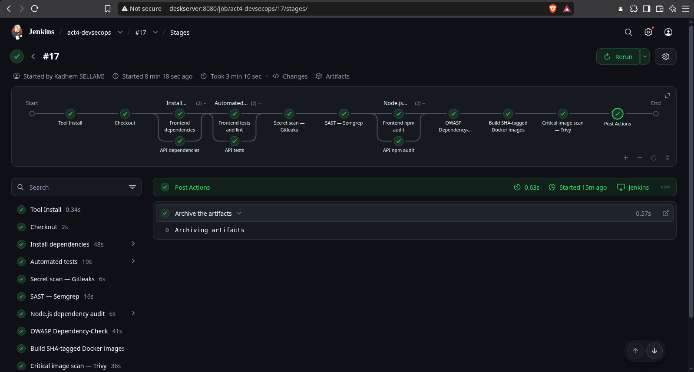
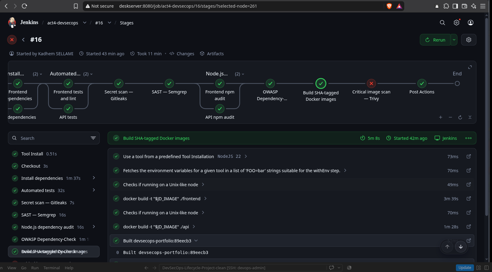
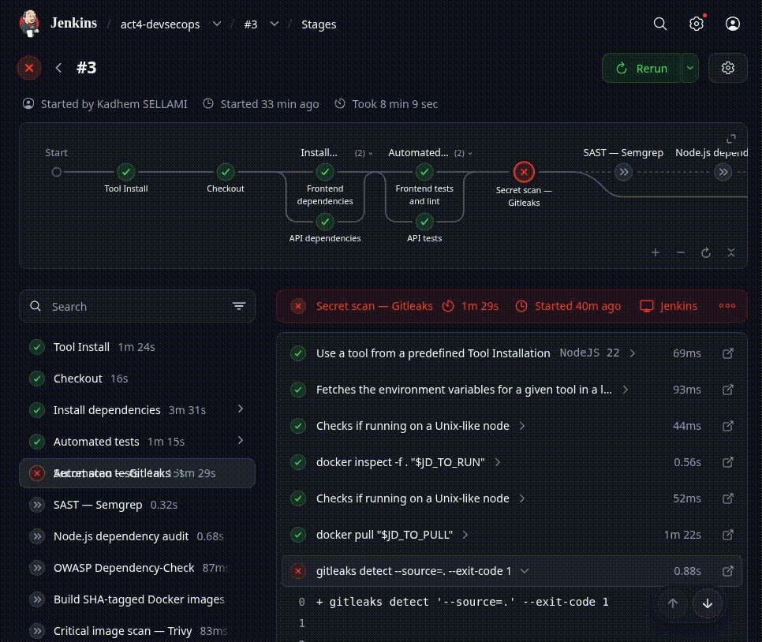
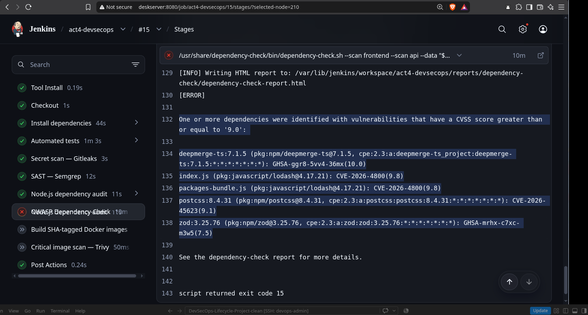
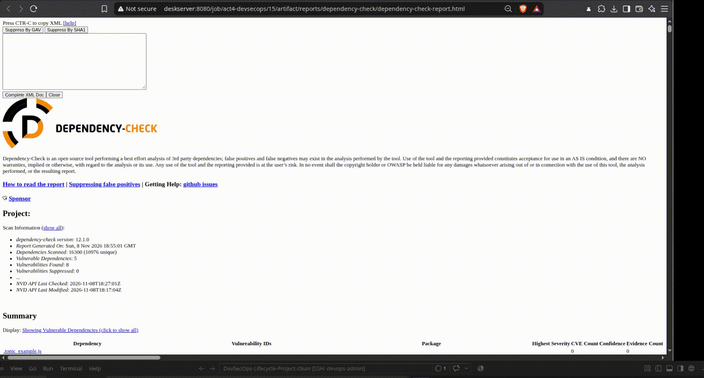
